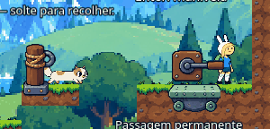
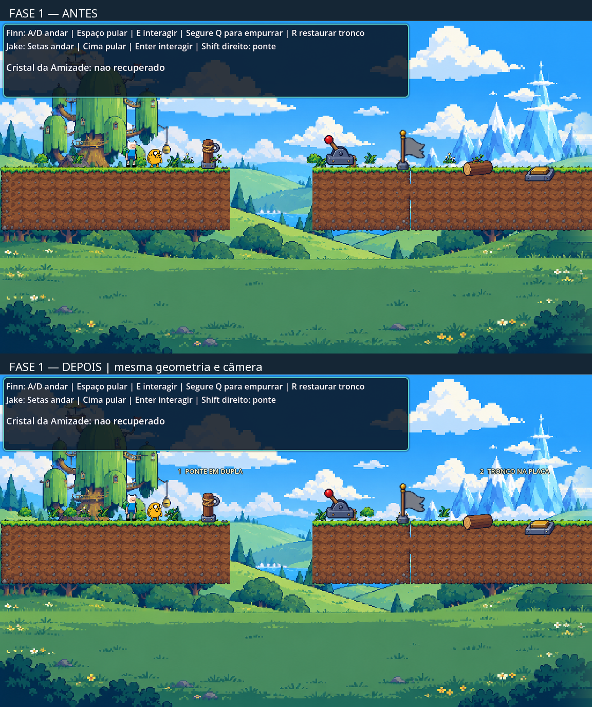
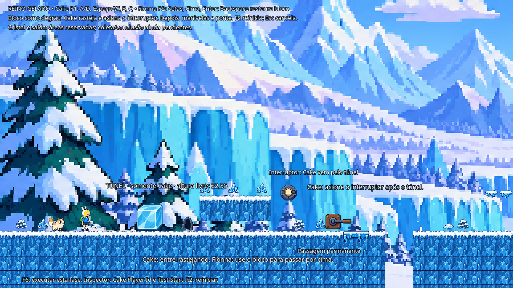

# Hora de Aventura: O Portal da Amizade

Documentação da entrega do projeto acadêmico de plataforma 2D cooperativa em Godot 4.7.2.

Este repositório reúne o relatório integral, inventário dos personagens, capturas reais e resultados dos testes. O escopo desta publicação é documental.

- [Relatório original completo](docs/ENTREGA_ORIGINAL.md)
- [Arquivos alterados e adicionados](docs/ARQUIVOS.md)
- [Inventário dos seis personagens](docs/INVENTARIO_PERSONAGENS.md)
- [Resultados dos testes no projeto original](resultados/original-results.json)

## Capturas reais

### Ponte de Cake

[Entrada](capturas/p1-bridge-entry.png) · [Centro](capturas/p1-bridge-center.png) · [Saída](capturas/p1-bridge-exit.png)

### Fase 1: antes e depois

### Fase 2: Reino Gelado

[Túnel e interruptor](capturas/level2-p1-tunnel-switch.png) · [Ponte](capturas/level2-p1-bridge.png) · [Área final reservada](capturas/level2-p1-final.png)

## Estado da entrega

458 verificações automatizadas passaram diretamente no projeto original. A avaliação manual da ponte recém-integrada, exportação e múltiplas resoluções continuam pendentes. A Fase 2 possui cenário e percurso demonstrável; coleta do cristal e conclusão conjunta ainda não estão implementadas.

O relatório abaixo foi preservado integralmente. Seus caminhos locais descrevem o ambiente de desenvolvimento; capturas e resultados publicados estão organizados nas pastas deste repositório.

---

# Entrega — ponte de Cake, acabamento da Fase 1 e cenário da Fase 2

Aplicado em 26/10/2026 ao projeto original `C:\Users\Ryzen\Documents\Codex\2026-10-22\quero-que-voc-me-ajude-a\outputs\adventure-time-phase1-corrigida`. Godot 4.7.2 preservado. As três tarefas foram executadas na ordem autorizada. Não foram iniciados outros personagens, fases ou sistemas de menu.

## A — Cake

A ponte usa a composição aprovada de **141×18 pixels visíveis**: as extremidades originais e o centro próprio de Cake de 88×9. O centro publicado é idêntico ao PNG aprovado na prévia, conferido por SHA-256. Os atlas e `animations.tres` originais não foram sobrescritos.

- A extensão usa os frames originais, revela o centro em passos inteiros de pixels e desloca a cabeça sem deformação. Há uma única representação visível de Cake.
- O apoio só é habilitado depois que a composição completa foi desenhada. Na execução sem janela, valida-se a geometria; a confirmação real de desenho foi exercitada separadamente em janela.
- O dorso e o contorno da cabeça têm apoio correspondente. A entrada sobe 12 unidades em relação às margens. A saída exige um pequeno salto para vencer o relevo preservado da cabeça; não se alterou salto, gravidade ou terreno para escondê-lo.
- A faixa válida é **±8 unidades em X e ±4 em Y na âncora**, exige chão, alcance da Area2D e capacidade `stretch`. Não há reposicionamento automático. O centro cresce e recolhe em 0,75 s cada, além dos clipes originais e margem de segurança de término.
- Cake fica parada. Soltar a habilidade ou cancelar enquanto Fionna depende da ponte deixa a retração pendente; o apoio continua presente. A análise considera a caixa atual e prevista da parceira, inclusive quando está no ar. Chão das margens ou passagem permanente abaixo do dorso constitui apoio independente.
- Retração sem dependentes retira o apoio antes de recolher o desenho. Ao final, sprite e controles são restaurados. A recuperação da dupla usa a rotina existente, com limpeza forçada apenas nesse contexto.
- A ponte de Jake e o controlador compartilhado não foram alterados.

Abrir `tests/cake_test.tscn`, escolher **Cake Player Id** na raiz e executar F6. A sala continua separada da primeira fase. A indicação antiga “ponte não implementada” foi substituída.

**Comportamentos verificados:** movimento/túnel anteriores; P1/P2; ativação no chão e recusa fora da área/no ar; ausência de apoio durante crescimento; travessia real com salto curto de entrada, caminhada no centro e salto curto de saída; espera com Fionna apoiada ou saltando; manivela e passagem permanente; reunião da dupla sem queda; cancelamento na extensão e no crescimento; cancelamento ocupado; restauração durante recuperação em cinco estados; reinício com ponte formada; extremos da faixa ±8 com entrada e saída físicas.

As rotas completas de `verify_cake.gd` são movidas por entradas de controle. Os casos isolados de `verify_cake_bridge.gd` usam posições iniciais artificiais para montar condições específicas e **não são contados como percurso completo**.

**Limitações:** avaliação manual da nova ponte ainda pendente; a pequena contração entre dois frames originais continua visível; existe salto de entrada/saída; build exportado e múltiplas resoluções não foram validados.

Capturas reais: `captures/p1-bridge-entry.png`, `p1-bridge-center.png`, `p1-bridge-exit.png` e equivalentes de P2. `cake-transformacao-real.gif` reúne 42 recortes de frames efetivamente renderizados pelo Godot, em preparação isolada da âncora; não é o demonstrador externo e não demonstra o percurso até ela.

## B — Trilha da Casa na Árvore

O acabamento foi deliberadamente localizado:

- Redistribuição dos 16 elementos de vegetação existentes, liberando a vizinhança da âncora, alavanca, tronco, placas e cristal.
- Vegetação desenhada atrás dos personagens e do terreno, preservando a leitura de pés e mecanismos.
- Identificação discreta, no mundo, das áreas de ponte, tronco/placa, dupla de placas e cristal/saída. HUD principal preservado.
- Geração por `@tool` protegida por um grupo único, evitando duplicação de decoração ao carregar a cena. As posições continuam definidas no script e são reproduzidas ao executar.

**Não houve alteração física nesta tarefa.** `level_1.tscn`, malha e grade do TileSet, background/parallax, câmera, spawns, ponte de Jake, alavanca, checkpoint, tronco/placa, placas conjuntas, cristal e saída conjunta permaneceram idênticos ao baseline. Os tratamentos anteriores de continuidade e remoção de células desalinhadas foram preservados. Não se afirma uma reconstrução ou nova arte de bordas.

Regressões: 49 verificações gerais da primeira fase, 154 de Jake/ponte, 73 de Finn e 228 de checkpoint/progresso, sem falhas. O teste de checkpoint inclui o percurso cooperativo, empurrão efetivo, placas, coleta e chegada física à saída; os demais casos de recuperação são identificados como preparações isoladas. Menu, Marceline, BMO e Fionna também passaram suas verificações existentes.

Antes/depois: `captures/phase1-before-576.png`, `phase1-after-576.png`, equivalentes em X1600 e `fase1-antes-depois.png`. Essas capturas inspecionam o cenário com posições de câmera controladas; não substituem a evidência da rota automatizada ou sua avaliação manual anterior.

## C — Passagem do Reino Gelado

Nova cena: **`res://level_2.tscn`**. Abrir diretamente no editor e executar **F6**. O menu e a transição da primeira fase não foram alterados.

A raiz expõe **Cake Player Id** (1 ou 2; padrão 2) e **Test Start** (Normal, Bloco, Túnel, Manivela, Ponte, Final). Fionna recebe o papel complementar. Os modos de teste mostram “INÍCIO DE TESTE” e não contam como conquista do percurso. O modo Manivela libera o primeiro mecanismo exclusivamente para sua avaliação isolada.

| Trecho | Conteúdo atual |
|---|---|
| Início | Dupla em posições separadas e seguras; instruções curtas; chão até a área do bloco |
| Bloco | Bloco de gelo marcado, controlador existente de empurrão; usado como degrau por Fionna; restauração próxima por R/Backspace ou reinício F2 |
| Túnel | X448–608; altura livre 22,35; corpo normal de Cake 28 e baixo 21; travessia real, recuo e restauração da postura preservados |
| Interruptor | Cake deve ter efetivamente entrado no túnel e interagir na área da saída; libera a primeira manivela |
| Primeira manivela | Fionna chega pelo alto com o bloco e estende a passagem de gelo; Cake não deixa Fionna isolada |
| Trecho intermediário | Pátio com plataformas laterais e chão contínuo; pontos livres para desenvolver desafios futuros |
| Ponte de Cake | Âncora em (1488;487), com a mesma lógica local, sem coordenadas da fase 1; vão X1504–1568; Fionna atravessa e aciona a segunda manivela |
| Passagem permanente | Plataforma de gelo permite Cake seguir depois da retração; proteção existente de trajetória ocupada preservada |
| Final | Espaço seguro para ambos; cristal e bandeira como marcadores **explicitamente reservados**, sem coleta/conclusão implementadas |

O pacote do Reino Gelado forneceu background, TileSet 32×32, terreno, pontes e decoração. O bloco, túneis, interruptor e manivelas usam recursos existentes do projeto. Nenhuma arte nova foi gerada para os cenários e nenhum asset externo foi baixado.

O panorama de 640×360 usa escala **uniforme 3,6×**, cobrindo o mundo de 2304 unidades sem repetição de bordas incompatíveis; parte da altura é recortada pela câmera. A câmera compartilhada usa Fionna/Cake, limites X0–2304/Y0–648 e o controle de distância já existente. Não se reescreveu seu sistema.

As passagens permanentes usam o tile de ponte de gelo com escala uniforme 2×. A faixa opaca principal tem 58 pixels, alinhada ao corpo de apoio de 58 unidades; as pontas de gelo abaixo são decoração, não trajetos. Nenhuma barreira artificial ou teleporte foi acrescentado ao fluxo normal.

**Funcional:** movimento, colisões, bloco/degrau, túnel, interruptor, duas manivelas, passagens permanentes, ponte de Cake, recuperação e F2. O percurso normal inteiro foi movido por entradas de controle, nos dois papéis, com `recovery_count == 0` até a área final.

**Preparado / pendente:** coleta do cristal, condição de saída conjunta e acabamento de seus estados finais. A fase **não está declarada concluível como jogo**. Não há física escorregadia; o movimento global permaneceu intacto. Os vãos de 64 unidades são adequados às demonstrações atuais, mas podem ser vencidos por salto comum: obrigatoriedade cooperativa e balanceamento final dos puzzles do SGDD continuam pendentes. A travessia de teste da ponte pousa no dorso e caminha sobre ele, sem contar um salto que ignore a ponte.

Capturas reais: `level2-p1-start.png`, `level2-p1-tunnel-switch.png`, `level2-p1-bridge.png`, `level2-p1-final.png` e equivalentes com Cake P2.

## Testes e limites da evidência

| Verificação na cópia externa validada | Resultado |
|---|---|
| Cake: movimento/túnel/ponte/percurso P1 e P2 | 90 verificações de comportamento, sem falhas |
| Cake em janela | Mesmos 90 comportamentos + 20 registros de captura; 110 registros não significam 110 comportamentos diferentes |
| Segurança complementar de Cake | 28 verificações locais, sem falhas |
| Fase 2 | 53 verificações; versão em janela também sem falhas |
| Primeira fase / Jake / Finn | 49 / 154 / 73, sem falhas |
| Checkpoint/progresso | 228, sem falhas |
| Marceline / BMO / Fionna / menu | 93 / 106 / 124 / 10, sem falhas |

Os testes em janela usam entradas automatizadas. As capturas foram inspecionadas visualmente; isso **não** equivale a jogar com duas pessoas, avaliar conforto manualmente ou validar outras resoluções/exportações. A captura real de transformação é um arranjo isolado, não uma rota iniciada no spawn.

Houve avisos ambientais de certificados, cache gráfico GLES e configurações pessoais do editor, além de avisos de recursos em uso ao encerrar algumas suítes anteriores. Os logs são preservados. As verificações finais não registraram falhas de comportamento ou erros de script/parse/carregamento de recursos na cópia validada.

**Validação direta no original concluída:** após autorização explícita do usuário, o próprio Godot 4.7.2 executou a importação padrão e os testes no projeto original. O bloqueio anterior da revisão automática foi resolvido por essa autorização; nenhuma edição manual de cache foi feita.

| Suíte executada no projeto original | Verificações | Falhas |
|---|---:|---:|
| Cake — movimento, túnel, ponte e percurso P1/P2 | 90 | 0 |
| Cake — segurança complementar | 28 | 0 |
| Fase 2 | 53 | 0 |
| Primeira fase | 49 | 0 |
| Checkpoint e preservação de progresso | 228 | 0 |
| Menu | 10 | 0 |
| Total desta reexecução direta | **458** | **0** |

As seis suítes retornaram código zero e não registraram erro de script/parse/carregamento de recursos. Logs detalhados: `logs/original-*.log`; resumo: `original-results.json`. Esses testes finais foram automatizados sem janela; as capturas e a inspeção visual anteriormente descritas continuam sendo da cópia externa, sem serem reapresentadas como novas capturas do original.

Após a importação e os testes, a auditoria SHA-256 conferiu os 1.834 arquivos de recursos/scripts do original: **nenhuma alteração inesperada** em relação ao conjunto publicado. O cache `.godot` foi atualizado exclusivamente pelo Godot, como autorizado, e permanece fora da comparação de recursos. A textura central nova foi importada pelo engine. Não se presume avaliação manual, build exportado ou múltiplas resoluções.

## Segurança, backup e arquivos

Não havia Git no projeto. Backup anterior às alterações: **`C:\Users\Ryzen\Documents\ChatGPT\SGDD\work\priority-cake-levels\backup-original`**.

Foram copiados `cake_player.gd`, `tests/cake_anchor.gd`, `tests/cake_test.gd`, `tests/cake_test.tscn`, `tests/verify_cake.gd`, `level_1.gd` e `level_1.tscn` (este último permaneceu intocado). Os relatórios externos anteriores estão em `backup-records`.

A tentativa inicial de cópia completa encontrou falta de espaço. Foram removidas somente as duas cópias redundantes criadas nesta rodada; o backup foi reduzido aos arquivos envolvidos e reutilizou-se uma cópia anterior, primeiro conferida por hash com o baseline. Não houve limpeza de arquivos do usuário ou do projeto.

Auditoria: **6 arquivos anteriores modificados, 13 adicionados, zero removidos e 1.815 arquivos anteriores preservados**. Os arquivos estão discriminados em `ARQUIVOS.md`; os manifests de publicação registram os hashes. Originais de arte, `player.gd`, Jake, checkpoint, controles, menu, HUD e câmera compartilhada permaneceram preservados.

Registros de aprovação: Cake mantém aprovação manual de movimento/túnel/poses anteriores; a ponte integrada requer avaliação manual nova. BMO e Fionna continuam aprovados manualmente. Marceline não recebeu aprovação manual presumida. A primeira fase continua como base aprovada, com o acabamento novo submetido à sua avaliação.

## Checklist manual curto

- [x] Importação padrão dos novos recursos pelo Godot 4.7.2, autorizada e executada; testes automatizados no original concluídos.
- [ ] Abrir o projeto no editor para a avaliação manual abaixo.
- [ ] F6 em `tests/cake_test.tscn`, testar Cake P1/P2; aguardar formação, entrar com salto curto e atravessar com Fionna.
- [ ] Soltar/usar Esc com Fionna apoiada e saltando; confirmar espera, manivela, apoio permanente e retorno de Cake aos controles. Reiniciar com F2.
- [ ] Abrir a primeira fase pelo fluxo atual: observar acabamento e repetir ponte/alavanca, checkpoint, tronco/placa, placas conjuntas, cristal e saída.
- [ ] F6 em `level_2.tscn`, **Test Start = Normal**: bloco/degrau, túnel/interruptor, primeira manivela, ponte de Cake, segunda manivela e reunião da dupla.
- [ ] Conferir que os marcadores finais dizem “pendente” e que os inícios de teste estão identificados.
- [ ] Avaliar manualmente visibilidade, conforto e ritmo dos saltos; exportação e múltiplas resoluções continuam fora da validação realizada.

Nenhum outro cenário ou sistema foi iniciado.
