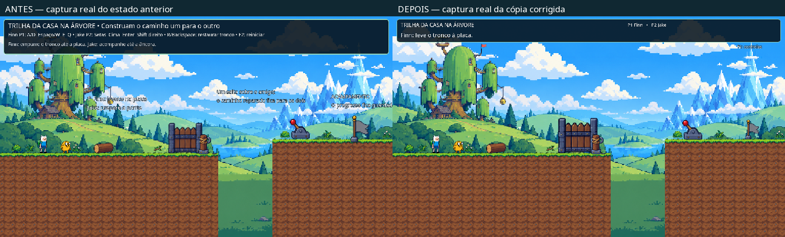
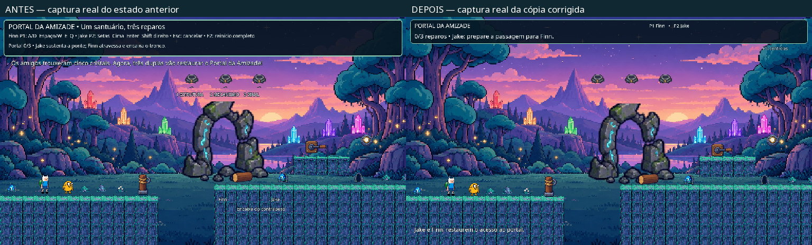

# Hora de Aventura: O Portal da Amizade

Atualização mais recente: **direção de arte das fases 1 e 6**, candidata para nova avaliação humana. [Causas, recursos, testes e checklist](jogo/DIRECAO_ARTE_FINAL.md). Os resultados anteriores não aprovam automaticamente esta apresentação.

[Placas](docs/direcao-arte-final/placas-fase1-antes-depois.png) · [Trilha](docs/direcao-arte-final/ambiente-fase1-antes-depois.png) · [Portal](docs/direcao-arte-final/portal-antes-depois.png) · [Vegetação](docs/direcao-arte-final/vegetacao-fase6-antes-depois.png) · [Reunião](docs/direcao-arte-final/confirmacao-dupla-antes-depois.png) · [Celebração](docs/direcao-arte-final/celebracao-antes-depois.png) · [Resultados no original](docs/direcao-arte-final/resultados.json)

Plataforma 2D cooperativa local para dois jogadores, projeto acadêmico em **Godot 4.7.2**.

Esta branch reúne a revisão de qualidade das **fases 1 e 6**. É uma versão para nova avaliação humana, com correções de pontes, contato com o chão, portões, tutorial, progressão e recuperação. As aprovações antigas de personagens não aprovam automaticamente os novos layouts.

## Abrir

1. Importe [`jogo/project.godot`](jogo/project.godot) no Godot 4.7.2 e aguarde a importação normal.
2. F5 mantém o fluxo do menu para a primeira fase. Ou abra [`jogo/level_1.tscn`](jogo/level_1.tscn) com F6.
3. Abra [`jogo/level_6.tscn`](jogo/level_6.tscn) com F6 para os três setores e a celebração, independentemente das fases intermediárias.
4. Na raiz, **Finn Player Id** / **Primary Player Id** alterna os papéis 1 e 2.

P1: A/D, Espaço/W, E, Q. P2: setas laterais, cima, Enter, Shift direito. F1 ajuda; Esc cancela ação local; F2 reinicia; R/Backspace repõe bloco próximo. No terminal, esquerda/direita escolhe, interação confirma.

## Revisão e evidências

- [Causas, correções, testes e checklist manual](jogo/REVISAO_QUALIDADE.md)
- [Resultados finais com comportamentos verificados](docs/revisao-qualidade/resultados.json)
- [Arquivos alterados nesta revisão local](docs/revisao-qualidade/arquivos-locais.json)

[Contato de Cake](docs/revisao-qualidade/cake-contato-antes-depois.png) · [Terminal contextual](docs/revisao-qualidade/terminal-contextual.png) · [Celebração](docs/revisao-qualidade/celebracao.png)

Os percursos das fases 1 e 6 foram executados por entradas normais automatizadas, com papéis padrão/invertidos, em 1152×648 e 1280×720, sem reposicionamento contado como travessia. As capturas renderizadas foram inspecionadas. Testes isolados provocam estados de risco e não substituem o percurso. Áudio ouvido, duas pessoas jogando, outro computador e build exportado continuam sem avaliação nesta revisão.

## Escopo preservado

Fase 2 sem redesign e com regressão do percurso existente. Seu cristal e conclusão conjunta permanecem pendentes do estado anterior. Fases 3–5 não implementadas. Arte original, versão, controles globais, menu, câmera compartilhada e HUD principal preservados. Os ajustes compartilhados estão descritos no relatório. Backups, caches e logs temporários não são publicados.

## Referências e histórico

[SGDD](docs/SGDD.pdf) · [Cronograma](docs/cronograma-disciplina.png) · [Relatório histórico da publicação anterior](docs/ENTREGA_ORIGINAL.md)

O relatório histórico e os resultados antigos descrevem versões anteriores; não são evidência de aprovação dos layouts desta branch.
