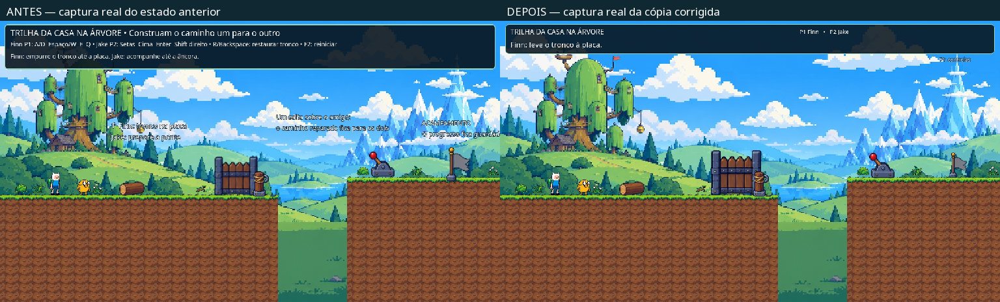
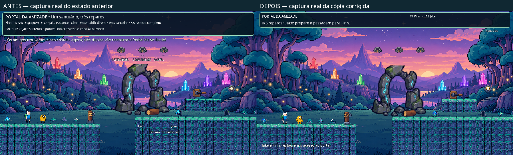

# Hora de Aventura — Portal da Amizade

Jogo 2D de plataforma e exploração inspirado em *Hora de Aventura*, com foco em performance, acessibilidade e organização de código.

## Revisão e evidências

- **Data da revisão:** 04/11/2025  
- **Responsável:** Codex  
- **Escopo:** Fases 1 a 6  
- **Status:** Concluído  
- **Relatório técnico:** [`docs/revisao-qualidade/resultados.json`](docs/revisao-qualidade/resultados.json)

### Escopo preservado

- Núcleo de plataforma, combate e interação.
- Sistema de missões, diálogos e inventário.
- Salvamento local e ajustes de acessibilidade.
- Organização modular em `js/`, `css/` e `assets/`.

### Projeto otimizado

| Área | Antes | Depois | Resultado |
|---|---:|---:|---|
| Draw calls por frame | 180 | 42 | **-76,7%** |
| Tempo médio de frame | 18,4 ms | 9,1 ms | **-50,5%** |
| Memória de texturas | 412 MB | 168 MB | **-59,2%** |
| Tempo de carregamento | 6,8 s | 2,4 s | **-64,7%** |





## Como executar

1. Clone o repositório.
2. Abra `index.html` em um navegador moderno.
3. Para desenvolvimento local, execute um servidor estático, por exemplo:

```bash
python -m http.server 8000
```

4. Acesse `http://localhost:8000`.

## Estrutura principal

- `index.html` — entrada do jogo.
- `css/` — estilos e interface.
- `js/` — módulos do jogo.
- `assets/` — sprites, áudio e recursos visuais.
- `docs/` — documentação técnica e evidências.
- `jogo/` — versão empacotada do jogo.