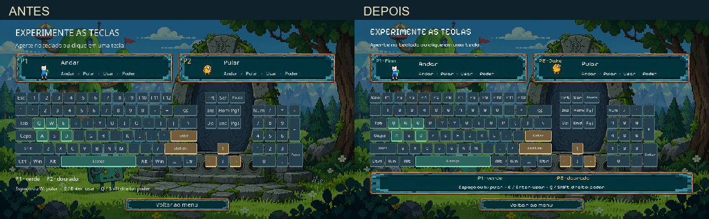
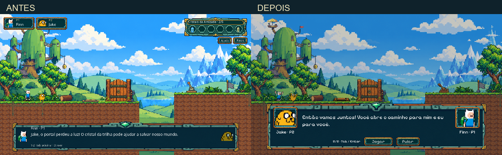
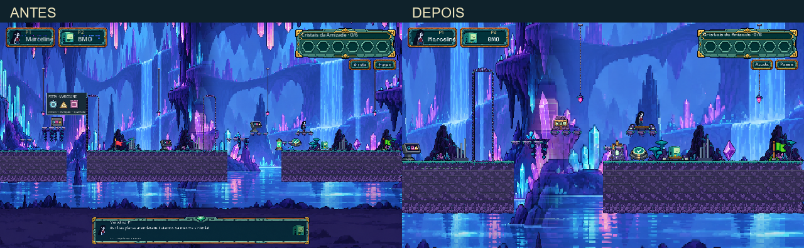
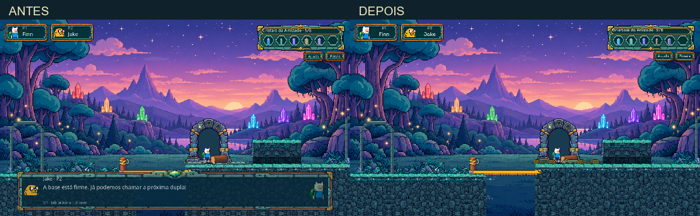
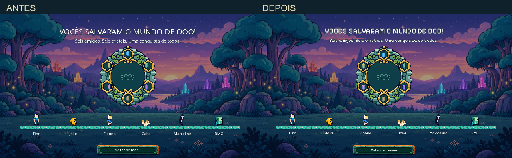

# Polimento de apresentação e entrada da ponte — 18/11/2026

Versão candidata à avaliação manual. Godot executado: **4.7.2.stable.official.ed1daf0bf**. Esta rodada não representa aprovação humana de conforto, aparência ou diversão.

## Correções e limites

| Relato | Causa verificada | Alteração | Verificação |
|---|---|---|---|
| Personagens/textos desalinhados no guia | Margens transparentes dos sprites e base vertical fixa nas demonstrações | Recorte opaco calculado uma vez, bases próprias, nomes/cores P1 e P2 e legenda inferior em moldura | Teclado real e clique; 104 teclas, Shift direito, animações e quatro resoluções |
| Fala fora da moldura e personagens andando durante leitura | Cartão antigo reativo, avanço automático e mundo sem pausa | Abertura modal com retratos enquadrados, fonte do jogo, Próxima/Jogar e Pular | Ambos imóveis, leitura, pulo da conversa, releitura, reinício e teclas mantidas |
| Caixas de conversa avulsas durante os puzzles | Mensagens disparadas por cada conquista e queda | Somente abertura e novas duplas da Fase 6 iniciam conversa; conquistas continuam no cenário/HUD | Percursos completos sem interrupções reativas |
| Placas e alavanca sem acabamento próprio | Desenho procedural e arte genérica | Seis atlas de placas de quatro estados e alavanca de quatro poses; detecção, capacidade e sinais preservados | Mecanismos acionados nas rotas; imagens renderizadas examinadas |
| Finn precisa saltar para entrar na ponte | Topo do apoio em Y391, cerca de 11,35 unidades acima da margem Y402,35 | Apoio local alinhado à margem; desenho acompanha o apoio | Finn entra caminhando nos dois papéis; soltura com parceiro no ar, passagem permanente e checkpoint |
| Reino Gelado com escala muito afastada | Fases 2–4 usavam a referência global maior | Referência local 1152×648 comum às seis fases; restauração ao sair | Rotas nas duas resoluções, enquadramento e telas; sem mudar project.godot ou zoom global |
| Final da caverna com cápsula e mecanismos desconectados | Bateria genérica sobre a borda e recorte excedente do receptor | Console e ressonador em PNG; ressonador em X1640, receptor em X1704, ambos apoiados; recorte do receptor corrigido | Percurso de Marceline/BMO nos dois papéis e inspeção da cena energizada |
| Cristais deslocados no medalhão final | Centros estimados diferentes dos encaixes reais do PNG | Centros corrigidos usando a imagem nativa | Vitória renderizada em quatro resoluções |

### Entrada da ponte: correção do diagnóstico inicial

O teste de reprodução fez Finn parar em X≈592. A primeira hipótese foi colisão com o corpo de Jake. A leitura posterior confirmou que ambos já usam máscara que ignora outros jogadores: o bloqueio vinha da borda elevada do próprio apoio. Não foi necessário alterar máscaras, colisão entre jogadores ou controlador compartilhado de ponte.

Baixar somente 1 pixel não corrigia essa borda. Após a autorização explícita para a correção completa, somente a altura do `BridgeBody` da Fase 1 foi alinhada ao piso esquerdo, em coordenadas relativas ao nó da ponte. O desenho já consulta esse apoio. **A entrada ficou caminhável; a margem de saída continua mais alta e mantém o pequeno salto existente.** Segurança, extensão, sustentação, retração e ponte de Cake não foram reescritas.

## Uso

- Abrir o `project.godot` do projeto original e executar normalmente. F6 continua disponível em `level_1.tscn` a `level_6.tscn`.
- Conversa de abertura: **Tab, Enter, E ou Espaço** avançam; **Esc** ou **Pular** encerram. A última fala usa **Jogar**. Soltar as teclas retoma sem salto/interação residual.
- **F3** relê a abertura/última troca de dupla; a releitura também pausa. **F1** conserva a ajuda opcional durante a fase; **F2** reinicia.
- P1: A/D, Espaço/W, E, Q. P2: setas laterais, seta para cima, Enter, Shift direito. Nenhum remapeamento ou duração de habilidade foi alterado.

## Sprites e animação

Novos PNGs em `Assets/03_Objects_and_Puzzles/cohesion_18_11/`. Os originais foram preservados. Texturas importadas com filtro Nearest no uso; nenhum plugin ou download de assets externos.

| Arquivo | Uso/quadros |
|---|---|
| `plate_forest.png` | Madeira e musgo; atlas 336×26, quatro células 84×26 |
| `plate_ice.png` | Pedra congelada; mesmo formato |
| `plate_cave.png` | Pedra, metal e ressonância; mesmo formato |
| `plate_workshop.png` | Cobre e esmalte da oficina; mesmo formato |
| `plate_sanctuary.png` | Pedra e latão do portal; mesmo formato |
| `plate_reunion.png` | Piso baixo com pegadas para reunião/confirmar, sem ícone flutuante; mesmo formato |
| `lever_forest.png` | Quatro poses 64×64; acionamento em 12 fps |
| `cave_console.png` | Console da ação de energia; dois estados 56×64 |
| `cave_power.png` | Ressonador de pedra/latão; dois estados 56×64 |
| `ambient_cloud.png` | Nuvem discreta para regiões externas, proporção preservada |
| `ambient_glint.png` | Quatro células 8×8, brilho lento e defasado |

As placas mostram base e extremidades mesmo ocupadas. Pressão, disponibilidade e conclusão selecionam quadros do atlas; o sprite não decide a progressão. Não foi criada placa artificial na Torre dos Espelhos, que não utiliza esse mecanismo.

Portões da floresta recolhem a folha em linhas de pixels por 0,28s, mantendo postes fixos. Portões regionais recuam e desaparecem em 0,28s, mantendo molduras. A lógica/collision de `CoopGate` continua sendo a única fonte de estado.

Nuvens lentas e dez pequenos brilhos por ambiente não têm colisão. Seus deslocamentos são discretos e independentes. Não há geração ou tratamento de imagens por quadro; atlas e recortes são preparados/carregados uma vez. Retratos usam cache por personagem.

## Testes executados e evidência

Os testes foram executados **com renderização**, entrada por InputMap/eventos e perfil de campanha isolado. As rotas das seis fases usam deslocamento, salto e interação: reposicionamento de preparação de testes isolados não foi contado como travessia. A prova da ponte não usa retorno por queda como progresso.

| Grupo | Comportamento realmente verificado |
|---|---|
| Fase 1 | Percurso completo padrão/invertido; empurrão, entrada caminhando na ponte, parceiro no ar, alavanca, passagem permanente, checkpoint, placas, cristal e saída |
| Fase 2 | Percurso completo padrão/invertido; túnel, recuo, ponte de Cake, manivela, passagem permanente e reinício |
| Fases 3–4 | Percursos completos padrão/invertido; pistas, terminal, confirmação conjunta, transporte, bloco, placa e conexões de energia |
| Fase 5 | Percurso completo padrão/invertido; espelhos, dois receptores, cristal e saída; layout preservado |
| Fase 6 | Três duplas, transições, terminal, confirmação, cristal, epílogo dos monumentos e conclusão padrão/invertida |
| Recuperação | Checkpoints/progresso preservados; quedas nos estados da ponte, controle recuperado, saídas inválidas recusadas |
| Conversas | Abertura das seis fases nos dois papéis, avanço e pulo, releitura, F2, espera de liberação de entrada; Espaço mantido não injeta salto |
| Telas | Teclado, HUD, seletor, medalhão, celebração e retorno; ajuste em 800×450, 1024×768, 1280×720 e 1920×1080 |

Percursos executados em **1280×720 e 1920×1080**. O arquivo externo `qa-summary.json` contém os resultados finais por suíte; o diagnóstico anterior à correção fica separado. Foram corrigidos durante a implementação um acesso de viewport na saída de cena e uma propriedade antiga de StyleBox. Seus testes foram repetidos antes da entrega; não se usa apenas o total de verificações como evidência visual.

Capturas reais de teclado, conversa, ponte, caverna, Fase 6 e vitória estão em `work/cohesion-2026-11-18/evidence` no workspace auxiliar. GIFs foram montados de quadros do Godot: entrada da ponte, teclado interativo e ambiente da floresta. O clip da ponte inclui extensão, entrada a pé, segurança com parceiro no ar e acionamento da alavanca. Não é uma montagem de arte sobre screenshot.

Comparações compactas publicadas em `docs/evidence/cohesion-18-11/`; as imagens completas, quadros e logs ficam fora do projeto jogável. Mudanças de enquadramento entre os pares de imagens são intencionais onde a referência local foi unificada.

## Preservação e arquivos

Backup externo completo anterior: `work/cohesion-2026-11-18/backup`, fora dos recursos do Godot, sem `.godot` ou `.git`. A auditoria não encontrou exclusão de arquivo. `project.godot`, sprites originais dos personagens, controladores de movimento/habilidades, pontes compartilhadas e layouts regionais foram preservados.

Arquivos existentes alterados, agrupados:

- UI: `scripts/ui/instructions_screen.gd`, `adventure_hud.gd`, `friendship_story.gd`, `friendship_ending.gd`, `game_screens.gd`, `menu_layout.gd`, `quality_presentation.gd` e `journey_interlude.gd` (proteção ao redimensionar durante a saída da cena).
- Fontes/painel: `scripts/core/journey_build.gd` (somente fonte) e `mechanisms/bmo_terminal.gd` (fonte e moldura, sem lógica de terminal).
- Integração local: `scripts/levels/journey_level_1.gd` (altura do apoio), `imported_phase_runtime.gd` (apoio inicial da dupla antes da leitura), `level_3.gd` (moldura da pista) e `monument_finale.gd` (nome do nó ambiental).
- Cenário: `scripts/puzzles/journey_plate.gd`, `scripts/scenery/forest_gate_finish.gd`, `forest_lever_skin.gd`, `level_identity.gd`, `local_mechanism_finish.gd`, `regional_gate_finish.gd`, `regional_layout.gd`, `regional_plate.gd`, `sanctuary_plate_finish.gd`, `world_atmosphere.gd`.
- Novos scripts: `scripts/scenery/mechanism_sprite.gd` e `cave_station_finish.gd`, com `.uid`; onze PNGs e metadados `.import`.
- Testes auxiliares externos: adaptação do driver e teste da Fase 2 à leitura modal, entrada a pé na Fase 1, novas suítes `verify_modal_story` e `verify_cohesion`. O nome antigo `verify_friendship_story` passa a executar o contrato modal solicitado, em vez do contrato reativo anterior.

Na publicação foi preservada a integração ESP32 da equipe, incluindo o `project.godot` próprio do checkout. Nenhum cache, backup, fonte de arte pesada, credencial ou sala de teste foi colocado em `jogo`.

## Origem da arte

Sprites produzidos com a ferramenta integrada **image_gen**, usando os assets locais como referência, depois preparados offline em atlas nativos com alfa/Nearest. O manifesto público `COESAO_SPRITES_PROMPTS_18_11.json` registra os prompts finais por arquivo. Fontes completas, fontes intermediárias e script de preparação ficam no workspace auxiliar, fora do jogo. Não houve uso de CLI/API de imagem, chave de API, plugin ou download de pacote externo.

## Checklist para aprovação manual

- [ ] Como jogar: retratos e nomes dentro dos cartões; teclas físicas/clique e legenda verde/dourada legíveis.
- [ ] Abertura: ambos imóveis; ler/pular; segurar Espaço e soltar ao final sem salto involuntário.
- [ ] Fase 1: aproximar Jake, formar ponte e fazer Finn entrar andando; avaliar o salto na margem final.
- [ ] Placas: observar antes, com personagem/bloco em cima e após solução, sobretudo Fases 1 e 6.
- [ ] Caverna: avaliar console, ressonador, placa e receptor como um conjunto apoiado.
- [ ] Fases 2–4: avaliar conforto do enquadramento comum; a dificuldade e os puzzles não foram ampliados.
- [ ] Final: avaliar centralização dos seis cristais, animação e retorno ao menu.

## Pendências e limites

Avaliação manual desta versão pelo usuário, conforto com duas pessoas, áudio, controle físico/ESP32, exportação, outro computador e desempenho em hardware diferente **não foram aprovados/verificados nesta rodada**. Capturas inspecionadas e testes automatizados não comprovam diversão ou ausência de todos os defeitos. Não foi criado novo executável ou ZIP.
