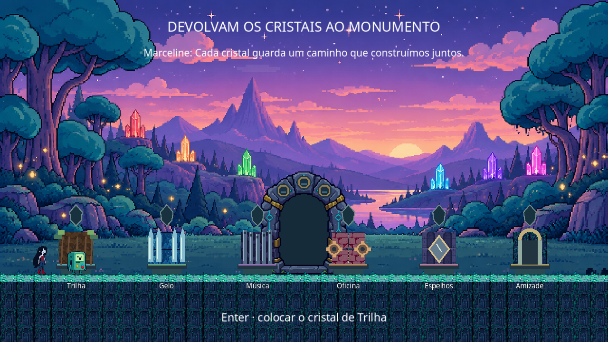
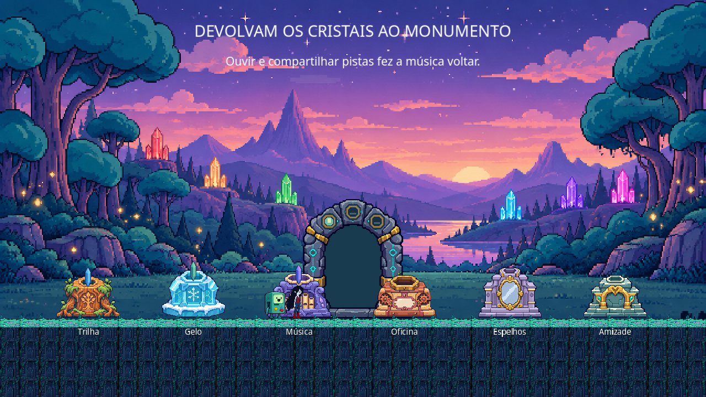
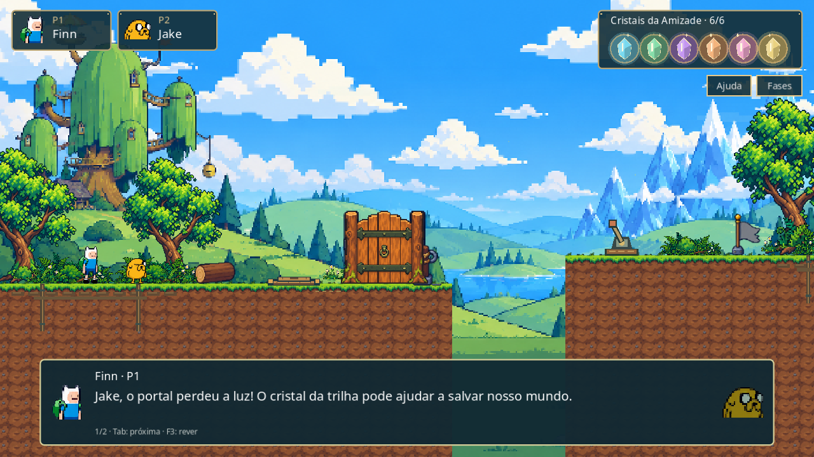
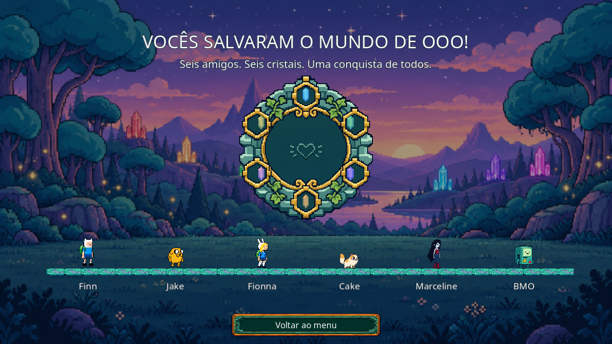

# Sprites da cerimônia, HUD e conversas — 17/11/2026

Esta rodada substitui as formas geométricas desenhadas em execução por arte raster importada. O acabamento novo está implementado e disponível para avaliação do autor; não representa aprovação manual por ele.

## Arte entregue

Os recursos ficam em `Assets/04_Interface/Sprites_Final/`, com filtro Nearest nas instâncias. Os PNGs anteriores e sprites dos personagens foram preservados.

| Recurso | Tamanho nativo | Uso |
|---|---|---|
| `monument_forest.png` | 112×96 | Madeira entalhada, raízes e musgo da Trilha |
| `monument_ice.png` | 112×96 | Gelo facetado e base nevada |
| `monument_music.png` | 112×96 | Pedra violeta e tubos musicais |
| `monument_workshop.png` | 112×96 | Biscoito, cobre e engrenagens |
| `monument_mirror.png` | 112×96 | Cantaria violeta e espelho dourado |
| `monument_friendship.png` | 112×96 | Pedra verde-azulada e arco do portal |
| `crystal_spin.png` | 256×40 | Oito frames 32×40 de rotação do cristal |
| `activation_strip.png` | 384×48 | Oito frames 48×48 de brilho finito |
| `hud_crystals.png` | 288×92 | Relicário com seis encaixes físicos |
| `dialogue_frame.png` | 384×89 | Moldura texturizada das conversas |
| `button_frame.png` | 96×33 | Bordas, cartões e botões adaptáveis |
| `victory_medallion.png` | 144×155 | Medalhão dos seis cristais na vitória |

As animações de rotação e brilho são atlas de sprites, não polígonos cuja largura varia. Cada monumento tem PNG próprio; o cristal animado e o brilho são camadas reutilizáveis. As seis cores usam modulação dos frames do cristal. Os personagens da comemoração mantêm seus frames originais, com a animação `celebrate` quando disponível e `idle` nos demais.

Geração: ferramenta integrada `image_gen`, sem download externo, API alternativa ou dependências novas. O conjunto final de prompts está em `SPRITES_PROMPTS_17_11.json`. Fontes grandes e preparação ficam fora do projeto jogável. A preparação aplica recorte da transparência, escala proporcional Nearest e alinhamento dos frames em células comuns; não processa imagens por quadro durante o jogo.

## Implementação

- `scripts/ui/sprite_art.gd`: recursos compartilhados dos atlas, gemas, efeitos e molduras em nove recortes.
- `scripts/levels/monument_finale.gd`: instancia os seis monumentos PNG, instala um cristal por interação e mostra o brilho correspondente. O piso não é redesenhado a cada quadro.
- `scripts/ui/crystal_emblem.gd`: mostra somente cristais recuperados e termina o brilho após a aquisição.
- `scripts/ui/adventure_hud.gd`: relicário, cartões dos personagens e botões com texturas dedicadas.
- `scripts/ui/friendship_story.gd`: conversa com moldura PNG; textos, prioridades e entradas preservados.
- `scripts/ui/menu_layout.gd`: molduras e estados dos botões reutilizam a textura, mantendo navegação e foco.
- `scripts/ui/friendship_ending.gd`: medalhão PNG, seis gemas animadas e amigos originais; base visual alinhada aos pés e retorno único ao menu.

## Validação

O Godot usado é 4.7.2.stable.official.ed1daf0bf. Os testes usam salvamentos isolados e renderização D3D12, com áudio Dummy.

- Percursos das seis fases exercitados pelos verificadores existentes, com papéis padrão e invertidos. Na Fase 6, o percurso normal passa pelos três setores, sai em dupla, caminha entre os monumentos e deposita os seis cristais por entradas de jogador. Os cinco cristais anteriores são uma precondição explícita do teste isolado da Fase 6; isso não é uma campanha contínua das seis fases.
- HUD, diálogos, seletor, teclado e retorno ao menu verificados; aquisição real e ausência de cristais inventados preservadas.
- Estados isolados de apresentação conferidos em 800×450, 1024×768, 1280×720 e 1920×1080. O percurso da Fase 6 e a cerimônia também são repetidos em 1920×1080.
- Inspeção das capturas: contorno dos monumentos, contato com o piso, encaixe das gemas, seis espaços do relicário, legibilidade da conversa e comemoração. Foram corrigidos um erro de tipagem, transparências indevidas no botão e a altura da borda da plataforma da celebração encontrados durante esta rodada.
- A verificação `verify_sprite_presentation` prepara seis cristais para examinar o epílogo separadamente, registra caminhada e interação reais nos monumentos e confere que os efeitos terminam. Essa preparação não conta como percurso das fases anteriores.

As evidências completas e logs ficam fora do jogo, na pasta de trabalho `work/sprites-final-2026-11-17`. Cópias selecionadas são publicadas em `docs/evidencias/sprites_17_11/`.

### Comparação real

São capturas renderizadas pelo Godot. Os estados preparados de HUD/epílogo servem para avaliar arte, não como prova de conclusão das fases anteriores.

| Antes | Depois |
|---|---|
|  |  |
|  |  |

O GIF local `work/sprites-final-2026-11-17/evidence/ceremony-recording.gif` registra a caminhada e os depósitos no epílogo com os seis cristais disponíveis. Não foi incluído no Git para evitar evidência pesada. O resumo portátil dos testes está em `evidencias/sprites_17_11/validacao.json`.

## Publicação

Branch: `codex/revisao-qualidade-fases-1-6`, preservando a main.

- `6d3cd11`: sprites dos monumentos, atlas e integração do epílogo — push concluído.
- `610d749`: HUD, molduras, conversas e comemoração — push concluído.
- A documentação, capturas e verificador de apresentação seguem em um commit próprio.

O checkout destinado à publicação também executou `verify_sprite_presentation` com relatório válido, sem falhas, preservando sua integração ESP32. Não houve validação com o hardware físico.

## Preservação e backup

Backup externo anterior às alterações:
`C:\Users\Ryzen\Documents\ChatGPT\SGDD\work\sprites-final-2026-11-17\backup`

A comparação com o backup registra apenas os seis scripts de apresentação alterados e os recursos novos desta rodada. Nenhum arquivo original foi apagado. Cenas, terrenos, puzzles, controladores dos personagens, pontes, checkpoints e arquivos de progressão permaneceram intactos. A publicação copia somente arquivos próprios da rodada e preserva a integração ESP32 e as configurações diferentes já existentes na branch da equipe.

## Avaliação manual curta

1. Abra `project.godot`, execute uma fase e observe cartões, encaixes vazios, coleta e brilho do cristal.
2. Leia uma conversa: confira as bordas, retratos e texto; Tab avança e F3 repete.
3. Conclua a Fase 6 com os seis cristais da campanha. No epílogo, caminhe até cada monumento e use E ou Enter conforme o jogador.
4. Confira os seis materiais, gemas girando, brilho breve, comemoração e botão de retorno.
5. Repita em tela cheia e na janela que será usada na apresentação.

Ainda pendentes: aprovação visual do autor, conforto com duas pessoas, audição do áudio, outro computador e build exportado. Não houve exportação nem recriação do ZIP nesta rodada. A aparência final não é declarada perfeita nem aprovada apenas porque a automação passou.
