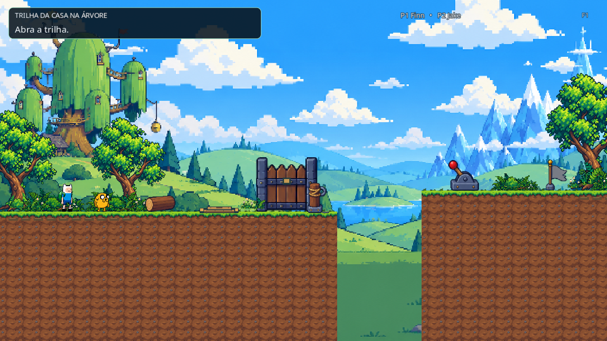
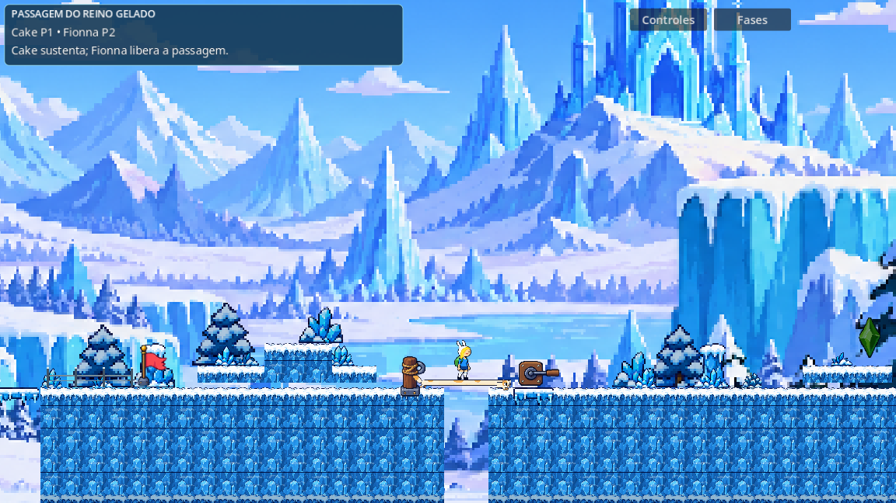
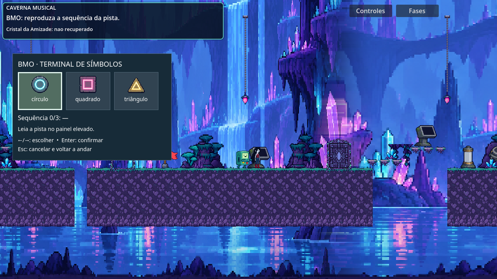
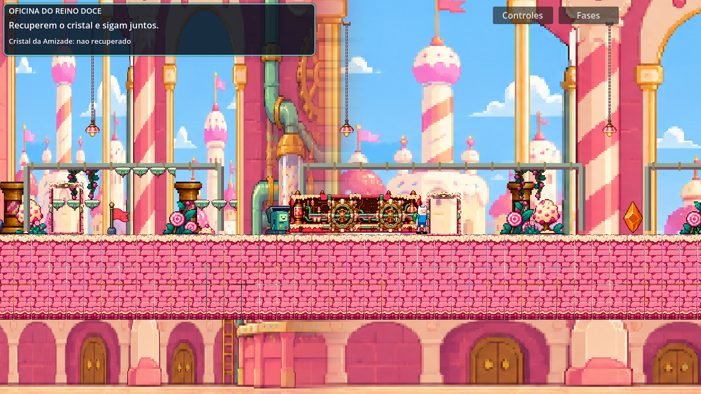
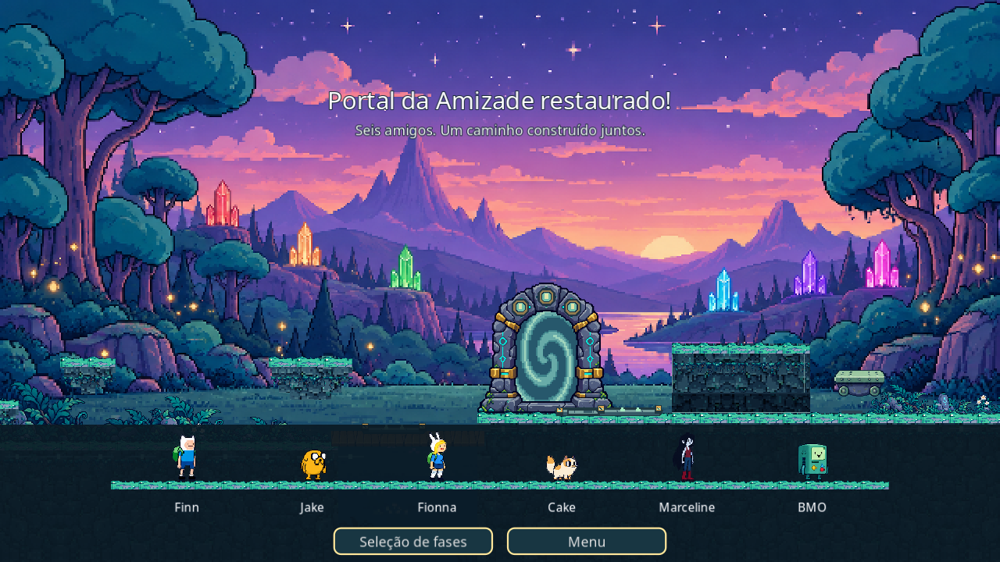

# Otimização — projeto de execução separado de QA/autoria

Recursos do projeto: **96.080.465 → 35.683.138 bytes**, redução de **62,86%**, excluindo cache e Git. ZIP fonte verificado: **29.709.953 bytes**. Não é um executável exportado; o ZIP fica na entrega local, não duplicado neste repositório.

O material retirado está preservado em [development/](../../development/README.md). O repositório e seu histórico conservam as fontes; a redução é da pasta `jogo/` e do pacote de execução/autoria entregue, não uma promessa de encolhimento do histórico Git.

## Código e organização

- Scripts em pastas por responsabilidade, preservando UIDs e nomes de classe.
- Cinco mecanismos promovidos a componentes de execução; quatro cenas pequenas substituem a extração de objetos de salas de teste na Fase 6.
- Nove texturas preparadas offline, idênticas ao processamento anterior; sem recorte/varredura de alpha em execução.
- Abertura do portal e coeficientes fixos da onda calculados uma única vez.
- Código morto da decoração e helper de extração de salas removidos.
- Todas as **379 funções** mantidas têm comentários em português e índice.

[Arquitetura](../../jogo/docs/ARQUITETURA.md), [funções](../../jogo/docs/CODIGO.md), [otimização](../../jogo/docs/OTIMIZACAO.md), [apresentação](../../jogo/docs/APRESENTACAO.md).

## Validação

[Resultados](results.json) distinguem os percursos completos das fixtures. Foram usados drivers de entrada nos percursos 1, 2, 3, 4 e 6, com papéis normais/invertidos; segurança atual de recuperação/checkpoints/transições; menu e seletor; verificação dos mecanismos independentes e equivalência matemática da animação. O ZIP foi extraído e importado do zero e a Fase 6 concluída nessa cópia. A cópia publicada também percorreu as Fases 3/4, preservando sua configuração global anterior.

[Auditoria semântica](semantic-audit.json): cinquenta scripts retidos iguais em comportamento após desconsiderar comentários/caminhos, quarenta e três cenas com dados iguais salvo referências de recursos. Oito arquivos de preparação/apresentação/construção têm as otimizações intencionais descritas.

Um teste antigo de checkpoint procurava `Players/Finn`, hierarquia que não corresponde à jornada atual. Ele foi arquivado e não conta como aprovação. A suíte atual `verify_journey_safety` verificou o checkpoint e a recuperação corretos. O runner portátil trata explicitamente o teste de menu que originalmente só imprimia resultados.

Medições locais de startup/processamento foram registradas, mas variam com cache/carga e não foram usadas para prometer ganho de FPS. Draw calls e memória de texturas em repouso continuam essencialmente iguais. O ganho comprovado é no tamanho do projeto/pacote e na eliminação de trabalho de preparação redundante.

## Capturas reais após a limpeza

Inspecionadas separadamente dos resultados automatizados; não houve redesign nesta rodada.

## Apresentação e limites

Godot foi aberto e observadas as abas do menu e fases 1, 2, 3, 4 e 6. Foi solicitada a abertura do roteiro e de três scripts no painel do Codex, com resultado `queued`; isso não foi apresentado como inspeção concluída dessas abas. O seletor nativo de recursos não aceitou os comandos de automação. O reinício do editor foi rejeitado pela revisão automática de aprovação por risco de estado não salvo; o editor não foi terminado. Foi solicitado ao usuário fechar somente o seletor com Esc.

Sem validação de build exportado, áudio ouvido, sessão com duas pessoas ou outro computador. A Fase 5 continua pendente e seus assets foram mantidos. Nenhuma dependência instalada, versão do Godot alterada ou edição manual de `.godot`.
