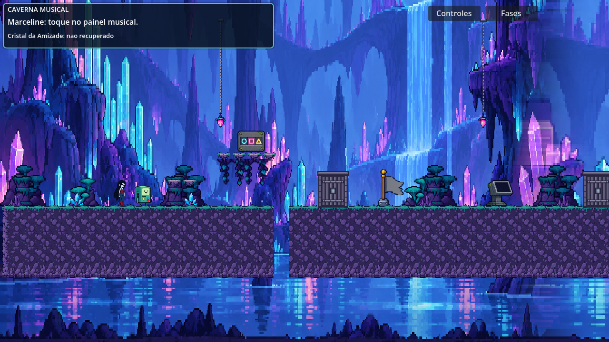
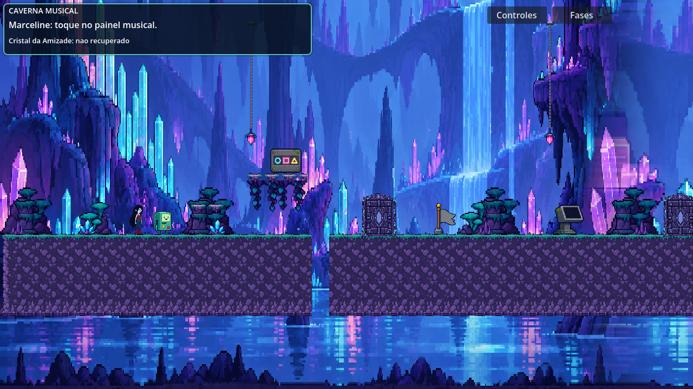
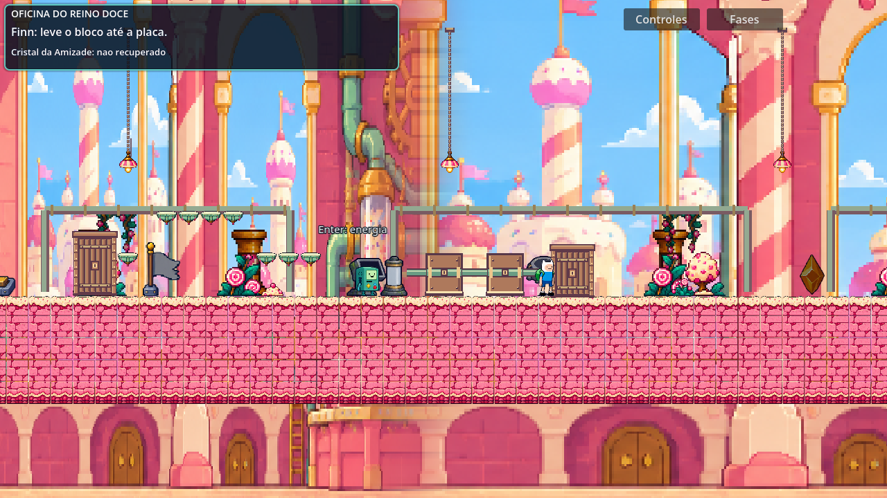
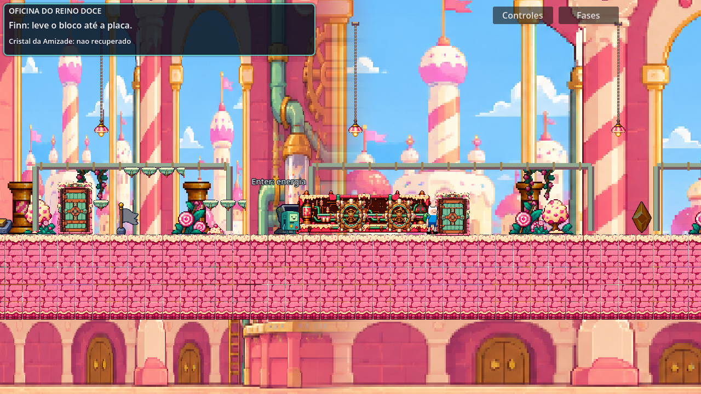
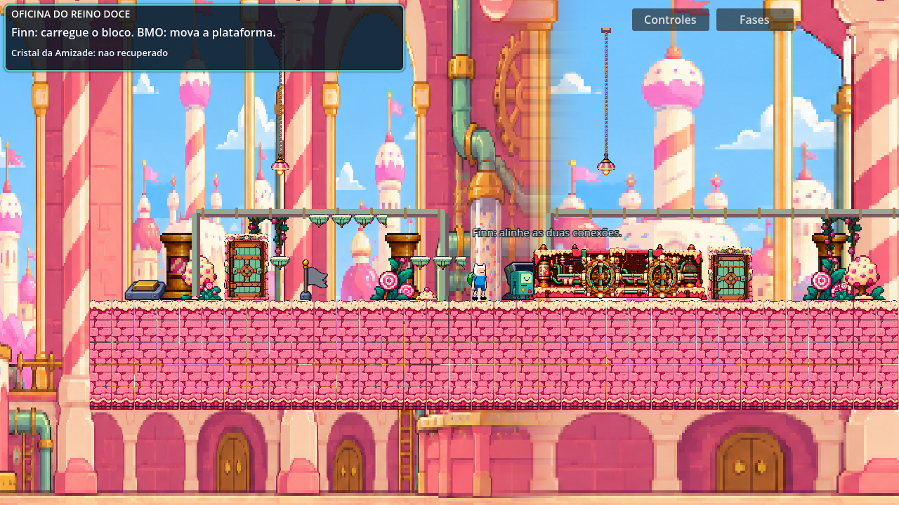
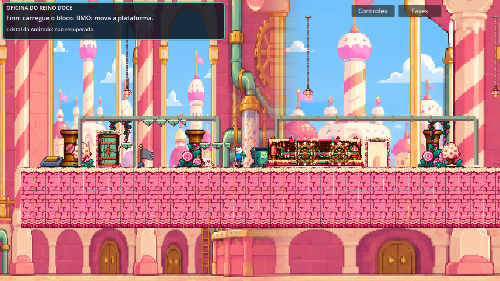
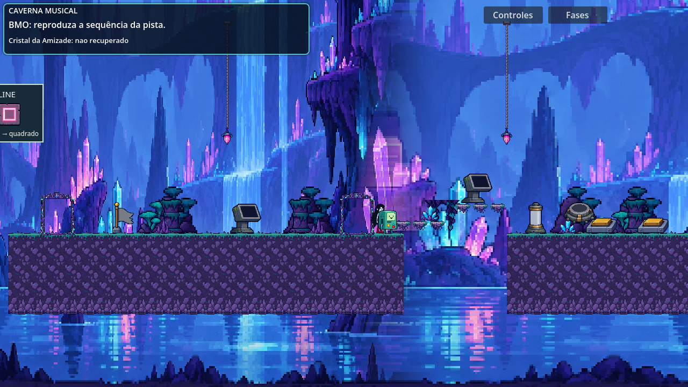
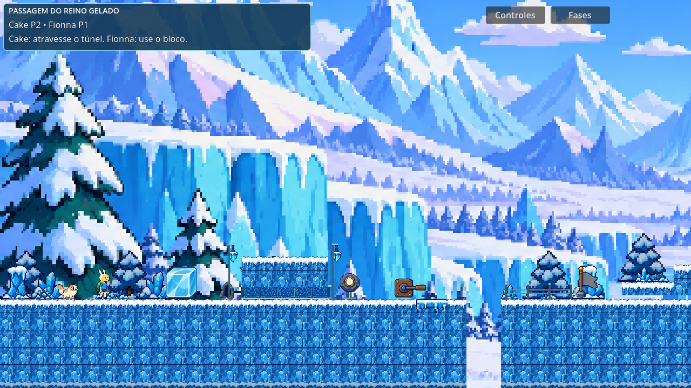
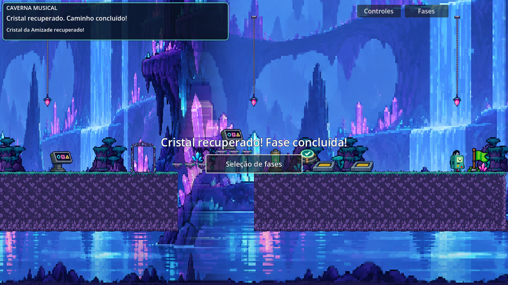
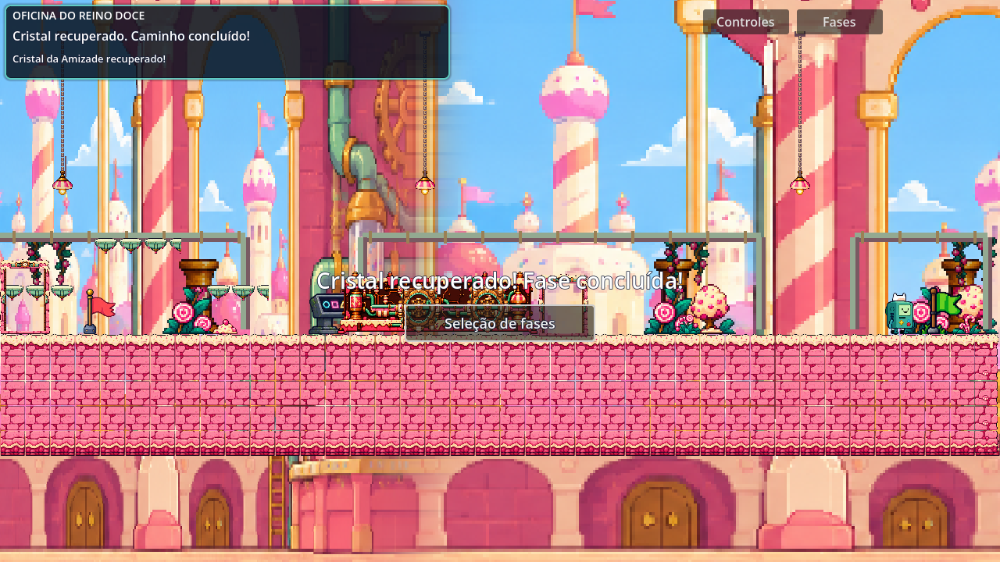

# Refino de pixel art — fases 2, 3 e 4

Portas temáticas e circuito detalhado, preservando regras e colisões. Relatório completo: [REFINO_PIXEL_234.md](../../jogo/REFINO_PIXEL_234.md). Prompts e proveniência: [recursos](../../jogo/Assets/03_Objects_and_Puzzles/pixel_refinement/PROVENANCE.md).

## Capturas reais comparáveis

Caverna, antes e depois, na mesma posição inicial em 1280×720:

Oficina/circuito, antes e depois, nas mesmas posições de fixture em 1280×720:

## Estados e integração

As imagens a seguir usam estados/posições preparados para inspecionar arte. Não contam como percurso concluído.

## Percursos

Capturas de conclusão dos percursos automatizados por entradas, com pares normais/invertidos, sem usar recuperação para avançar:

Os relatórios selecionados estão em [results.json](results.json). D3D12 nas janelas 1280×720 e 1152×648; portas/circuito também conferidos em Compatibility. A inspeção das imagens foi realizada separadamente das asserções.

Pendentes: avaliação humana da aparência desta revisão, sessão com duas pessoas, áudio ouvido, build exportado e outro computador. Quantidade de verificações não comprova diversão nem aprovação estética.

## Auditoria da cópia publicada

Foram encontradas e preservadas duas diferenças anteriores a esta rodada: o `project.godot` original declara 1280×720, enquanto o arquivo já versionado usa os valores padrão do Godot; um UID de teste local também não estava versionado. Esses arquivos não foram sincronizados indiscriminadamente nem alterados para obter igualdade artificial. Os arquivos desta rodada são idênticos no original e na cópia de publicação.

A cópia publicada foi importada pelo próprio Godot e validada separadamente com sua configuração existente: percursos completos 3/4 com papéis normais/invertidos e renderização do circuito/portas. Ambas as execuções terminaram sem falhas e sem mensagens de erro/aviso no console de execução. Captura da oficina publicada também inspecionada. A apresentação pode ter enquadramento/escala de tela diferentes por causa da configuração prévia preservada.
