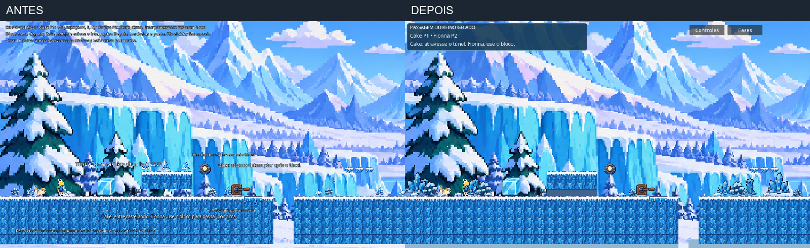
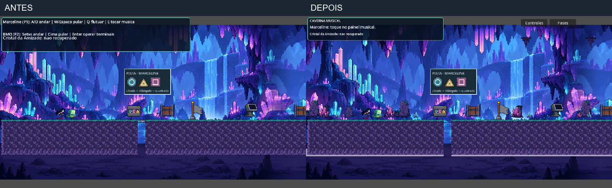
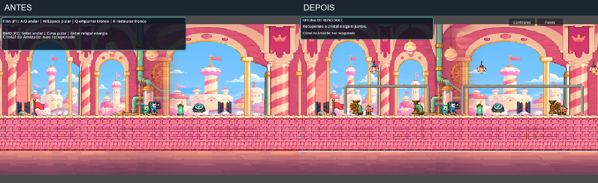
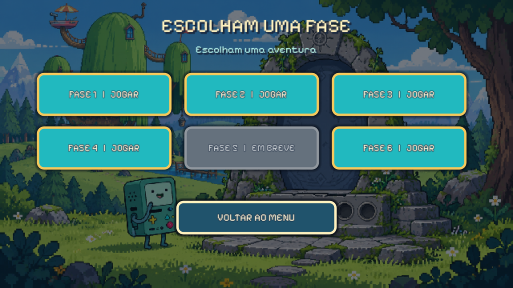

# Cenários 2, 3 e 4 — composição e apresentação

Godot 4.7.2 preservado. Rodada de 27/10/2026. Referência: direção de arte existente nas fases 1 e 6. Foram reutilizados somente os pacotes locais e suas resoluções nativas; não houve download ou geração de arte nova.

## Acesso e aprovação

Fases 2 e 6 habilitadas na seleção, junto às fases 1, 3 e 4. A Fase 5 continua bloqueada, aguardando o molde do colega. Os cenários 1 e 6 foram registrados como finalizados e aprovados pelo usuário em `STATUS_CENARIOS.md`; seus recursos não foram alterados.

## Mapas de composição

**Fase 2:** clareira congelada de partida → bloco e túnel recortado no gelo → área aberta da primeira manivela → formações de gelo e plataforma → vão/âncora de Cake → jardim de gelo e área final reservada. As formações maiores estão em planos intermediários; neve baixa emoldura o piso. O túnel ganhou parede de fundo de gelo mais escura sem reduzir a altura livre. A decoração antiga foi substituída por uma única composição, evitando duplicação por `@tool`.

**Fase 3:** entrada de cristais → clareira do painel musical → checkpoint → espaço aberto do terminal de símbolos → câmara de energia → cristal e saída. Formações minerais de alturas diferentes, colunas afastadas e estalactites escuras criam planos. Os cristais decorativos usam luminosidade discreta em ciclos diferentes. Pistas, personagens e mecanismos mantêm espaço visual livre.

**Fase 4:** baia de transporte/tronco → checkpoint → baia de energia → alcova de conclusão. Tubos de fundo conectam visualmente as áreas; pilares, engrenagens e luminárias usam o pacote doce existente. Luminárias variam sutilmente o brilho e algumas engrenagens oscilam. Esses elementos não recebem colisão nem sugerem uma nova solução obrigatória.

As superfícies jogáveis, distâncias de salto, posições dos puzzles, colisões e sequência de progressão foram preservadas. Esta rodada trabalha o layout visual em torno do percurso existente; não é um redesenho funcional dos puzzles. Nenhuma capacidade ou controle foi alterado.

## Apresentação

Fase 2: objetivo curto e papéis atuais no cabeçalho; orientações do túnel e das manivelas aparecem no contexto. Coordenadas e explicações técnicas saíram do fluxo normal. Inícios especiais do Inspector continuam identificados como teste. A área final continua explicitamente marcada como coleta/conclusão pendentes.

Fases 3 e 4: cabeçalho compacto com objetivo imediato e cristal; controles em ajuda opcional e botão de retorno à seleção. A conclusão usa uma única mensagem, removendo a duplicata recortada da bandeira. O HUD alterado é exclusivo dessas cenas; fases 1 e 6 não usam este adaptador.

## Evidências reais

Antes à esquerda, depois à direita. Capturas do Godot executando o projeto original, no mesmo tamanho de referência; a montagem só organiza as imagens.

## Validação

Percurso da Fase 2 com Cake P1/P2: bloco, túnel nos dois sentidos, postura, interruptor, manivelas, ponte segura, reunião e reinício. Não é validação de conclusão completa: não há coleta/saída implementadas nessa fase.

Fases 3 e 4: percursos completos por Input Map, sem reposicionamento para completar, em 1152×648 e 1280×720; mecanismos, cristal e saída conjunta. Recuperação/cancelamentos/reinício também verificados em casos isolados preparados por script, separados da evidência de percurso normal.

Seleção: fases 2 e 6 abertas pelo sinal real dos respectivos botões em duas resoluções. Somente Fase 5 bloqueada. Menu principal e seleção também conferidos em proporção 4:3. Ajuda opcional cabe nas janelas testadas. O novo cenário não cria corpos de colisão. Regressão completa da Fase 6 com os dois papéis, até a celebração. Fase 1 abre pelo menu e todos os seus arquivos permanecem idênticos ao início da rodada.

Inspeção visual de capturas: entrada, túnel e ponte gelados; painel/terminal da caverna; entrada, energia e final da oficina; ajuda opcional e seleção. Sem erros de execução nas suítes finais registradas. A automação não comprova conforto ou diversão; os três novos cenários aguardam avaliação humana.

## Arquivos e reversão

`region_scenery.gd` e seu UID são novos; `level_2.tscn`, `level_3.tscn` e `level_4.tscn` apenas recebem a referência da camada visual. `level_2.gd` deixa de criar a decoração antiga para não duplicar instâncias. `imported_phase_hud.gd` organiza a apresentação exclusiva das fases 3/4. `phase_select.gd` habilita 2 e 6. Dois testes existentes atualizados e um teste novo de apresentação/acesso, mais README e documentos de estado.

Backup externo: `D:/TEMP/cenarios-2-3-4-2026-10-27/backup-original`. Estado anterior e manifesto das mudanças no diretório pai, junto aos logs e capturas. Nenhum asset original foi apagado ou regravado. Nenhuma mudança de versão, câmera principal, resolução global, movimento ou controles.

## Pendências e teste manual

Fase 2 ainda precisa da coleta de cristal e conclusão; essa pendência não foi escondida pelo acesso no menu. Os mecanismos implementados das fases 3 e 4 continuam sendo os recebidos: esta apresentação não equivale à realização de todos os desafios completos do SGDD. Fase 5 aguarda o colega. Não houve teste de áudio, com duas pessoas, build exportado ou outro computador nesta rodada.

Use F5 → Jogar, ou abra as cenas e execute com F6. P1: A/D, Espaço/W, E, Q. P2: setas, Cima, Enter, Shift direito. Esc cancela; F2 reinicia. Confira leitura dos mecanismos, contato da decoração com o piso, travessia do túnel/ponte, ajuda opcional e conclusão das fases 3/4. Avalie a composição dos novos cenários; 1 e 6 permanecem encerrados para ajustes estéticos.
