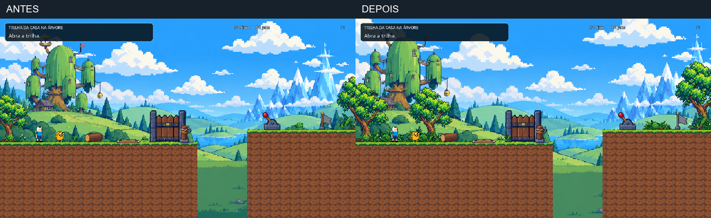
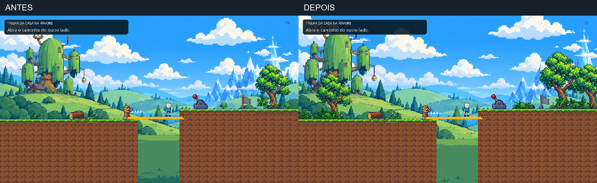
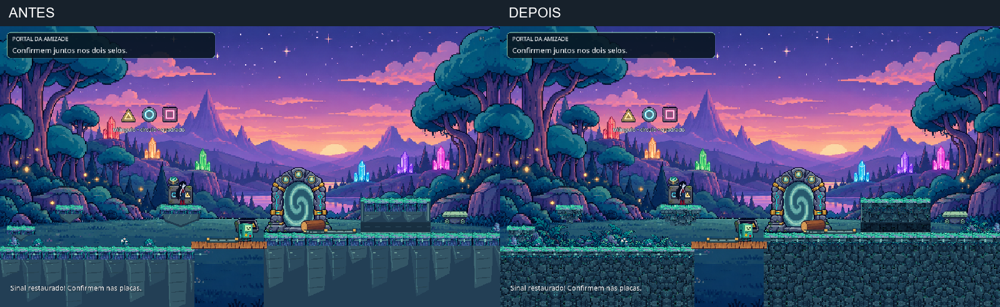
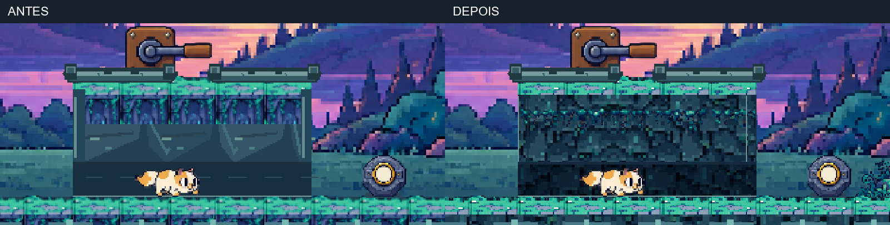
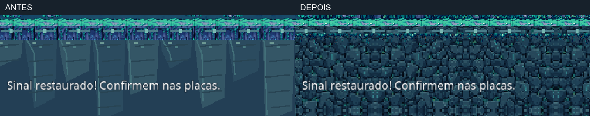
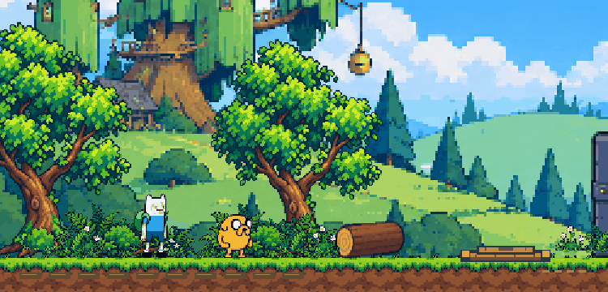

# Pixel art e composição ambiental — fases 1 e 6

Revisão implementada no Godot 4.7.2 em 27/10/2026. Candidata à avaliação visual do usuário; não há aprovação humana desta versão. Preserva a direção de arte anterior, as superfícies físicas, personagens, habilidades, regras e progressão. Não redesenha a Fase 2.

## Referências e decisões

Foram consultados os artigos oficiais [Hollow Knight: Then and Now](https://www.teamcherry.com.au/blog/hollow-knight-then-and-now) e [The Green Path](https://www.teamcherry.com.au/blog/the-green-path-a-hollow-knight-tour), da Team Cherry, e a [apresentação de Super Mario Bros. Wonder](https://www.nintendo.com/us/whatsnew/experience-the-unexpected-in-super-mario-bros-wonder-gameplay-presentation/), da Nintendo. A aplicação é conceitual: profundidade por planos, ambientes reconhecíveis e vegetação organizada em torno de espaços legíveis. Não foram incorporados assets externos nem copiados layouts. A consulta foi aos textos oficiais, não uma análise jogada desses títulos.

Mapa visual preservando o percurso físico:

* Fase 1: clareira de partida → travessia aberta → bosque do acampamento → corredor de duas alturas emoldurado → clareira do cristal.
* Fase 6: terraços de sinal → clareira central do portal → túnel de pedra e raízes → jardim rochoso lateral.

As árvores e moitas reforçam esses grupos; as áreas de ação continuam abertas. Não se adicionaram salas ou novas ações obrigatórias. O fundo da Fase 1 recebe parallax discreto, sem mudar a câmera ou a resolução global.

## Texturas e integração

Quatro PNGs novos, mantendo todos os originais: rocha azul-acinzentada, franja de musgo/raízes, vegetação verde da Casa na Árvore e vegetação azul-verde do santuário. A geração usou imagegen integrado, com referências internas; veja `ARTE_PIXEL_PROMPTS.md`.

O material de pedra substitui as faces planas anteriores no subsolo, ilhas e túnel. A grade lógica é de 64 pixels, apresentada em 128 unidades do mundo, com amostragem nearest e repetição espelhada. Não há suavização global. Um pequeno adaptador conserva proporção, recorta transparência e prepara texturas em cache; os PNGs não são regravados. A vegetação usa resoluções lógicas adequadas ao grupo e alfa binário para evitar halos.

O interior do túnel é mais escuro que o teto e o terreno, mantendo a leitura de Cake. Raízes ficam na face de pedra, fora da altura livre. As ilhas mantêm as superfícies e ganham bordas inferiores em degraus de pixels. Nenhuma colisão foi ampliada para acomodar a arte.

Na Fase 1, árvores existentes e novas moitas criam volumes intermediários. A brisa existente é reutilizada com fases diferentes e bases fixas. O panorama mantém sua proporção, passa de escala 1,8 para 2,0 e desloca no máximo 52 unidades dentro da sobra da imagem. O teste verifica cobertura de toda a área de referência ao longo do percurso.

## Comparações reais

As imagens anteriores foram reaproveitadas da entrega imediatamente anterior somente após comparar os arquivos do projeto com aquela versão. As imagens novas foram capturadas no Godot executando o projeto original. As montagens abaixo apenas colocam capturas lado a lado; não representam arte gerada como gameplay.

## Validação e limites

Execução com renderização OpenGL no projeto original, entrada simulada pelo Input Map e ambos os papéis. Percursos completos das fases 1 e 6 em 1152×648 e 1280×720; a suíte da Fase 1 também verifica proporção e cobertura do fundo. A suíte da Fase 6 inclui travessia/recuo do túnel, terminais, três reparos, confirmação e celebração. As preparações de estados isolados não contam como percurso.

Regressões específicas: recuperação antes/depois do checkpoint, preservação dos reparos, cancelamentos e reinícios; placas e vegetação apoiadas; estados visuais do portal; Fase 2 com seu percurso e mecanismos existentes. Não foram detectados erros de execução nos registros desta rodada. Resultados detalhados: `../docs/pixel-ambiente/resultados.json`.

Inspeção de capturas reais: início e ponte da Fase 1, rotas complementares, terreno/ilhas da Fase 6, Cake no túnel, portal e celebração. A primeira escala da rocha ficou excessivamente miúda e foi ampliada visualmente antes da validação final. Não se afirma perfeição, diversão comprovada ou aprovação do usuário. Não houve teste com duas pessoas, áudio audível, outro computador ou build exportado nesta rodada. A gravação curta mostra a brisa em enquadramento fixo; não é gravação integral das fases. A repetição do material pode ser percebida nas grandes massas; nenhuma nova variação de colisão foi introduzida para disfarçá-la.

## Arquivos e reversão

Alterados: `sanctuary_masonry.gd`, `stage_scenery.gd`, `README.md`.
Adicionados: `pixel_environment.gd`, `tests/qa_forest_depth.gd`, quatro PNGs com metadados de importação, este relatório e os prompts. UIDs gerados pelo Godot são preservados quando presentes.
Backup externo: `D:/TEMP/portal-pixel-ambience-2026-10-27/backup-original`. O manifesto anterior está em `baseline.json`, no diretório pai. As evidências e logs completos ficam fora dos recursos do jogo. Somente comparações selecionadas e resultados portáteis são publicados.

## Avaliação manual

Abra `level_1.tscn` ou `level_6.tscn` e execute com F6. As propriedades de papéis na raiz continuam disponíveis. P1: A/D, Espaço/W, E, Q; P2: setas, cima, Enter, Shift direito. F2 reinicia.

1. Observe o contato das plantas com o chão e a leitura das placas com personagens sobre elas.
2. Atravesse a ponte da Fase 1 e confira a passagem do cenário aberto ao bosque.
3. Na Fase 6, percorra o túnel de Cake nos dois sentidos e observe teto, entrada e saída.
4. Com Marceline/BMO, confira as bordas das ilhas e a distinção entre caminho e decoração.
5. Complete os reparos e compare a clareza do portal e dos mecanismos nas duas resoluções.
6. Avalie a densidade da vegetação e a brisa; a aprovação estética permanece sua.
